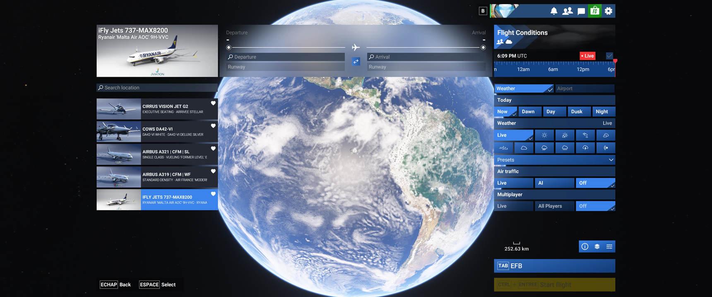
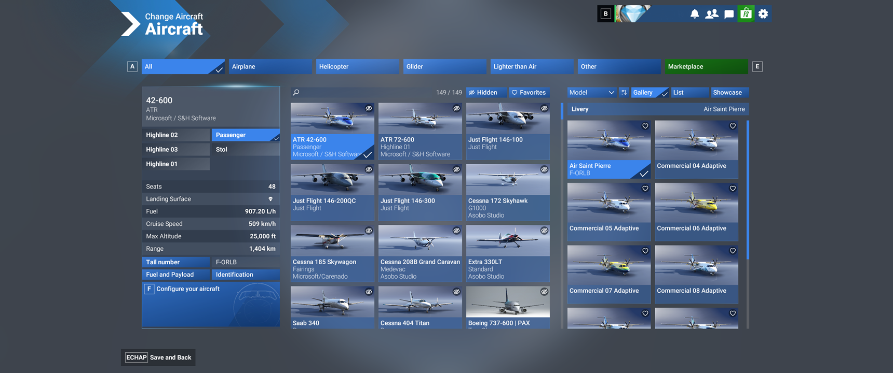
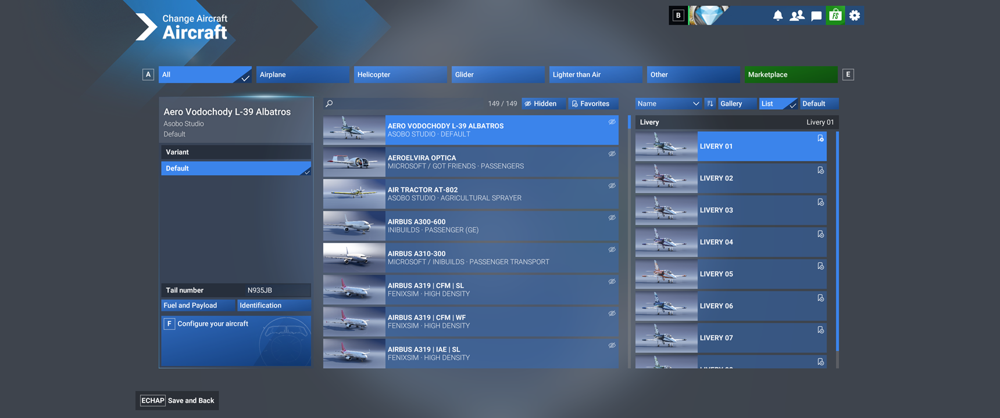
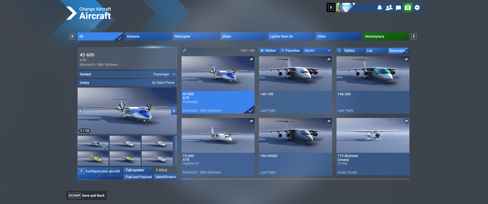
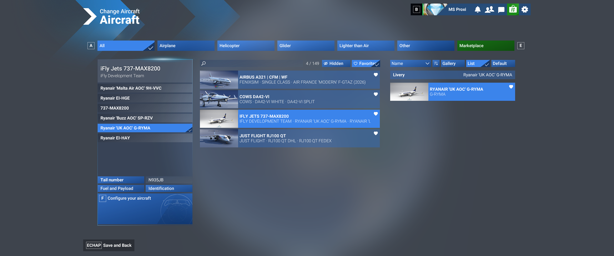
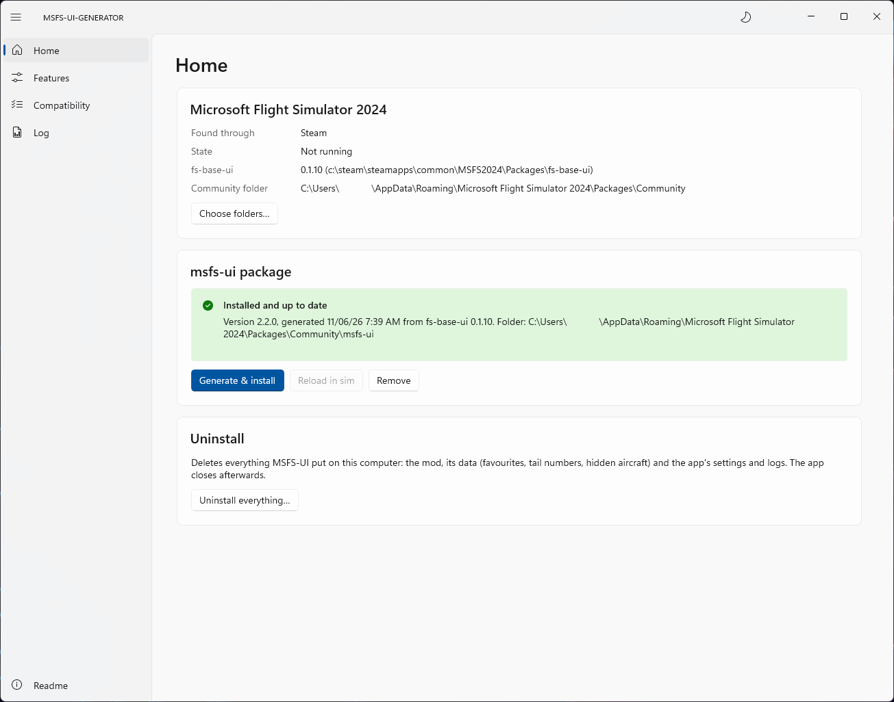
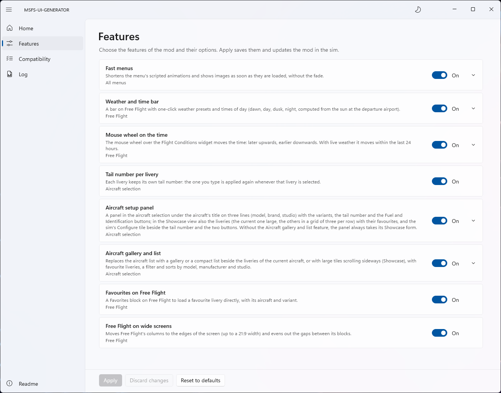

# MSFS-UI

A mod of the **Microsoft Flight Simulator 2024** main menu, and the Windows app that installs it.

- **MSFS-UI-GENERATOR**, the app: choose the features and their options (applied live while the sim runs), generate the `msfs-ui` package and install it in the sim's Community folder, check that the sim still offers what the mod needs, read the mod's log; **Remove** takes the mod away, **Uninstall everything** also deletes its data and the app's settings.
- **msfs-ui**, the package: faster menus; a weather and time bar on Free Flight with presets (those of other packages too), METAR, sun times and traffic; the wheel on the time; favourite liveries loaded in one click; Free Flight laid out to the edges of wide screens; an aircraft gallery and list with search, favourite liveries, hidden aircraft and sorts by model, manufacturer and studio, the current aircraft's liveries as large tiles beside it, and a Showcase view of large tiles; a setup panel for variants, liveries and tail number; a tail number per livery; the last view and the last aircraft remembered across restarts. Everything it shows is made of the sim's own components; its data (favourites, tail numbers, hidden aircraft, last choices) is written at once to files of its own, kept after a restart.

> [!WARNING]
> A personal project, not affiliated with, endorsed by or supported by Microsoft or Asobo Studio. The mod relies on undocumented parts of the sim's menu that an update may change: use it at your own risk. **Remove** on the app's Home page brings the original menu back; no file of the sim is ever modified.

Version 2.2.0, tested on MSFS 2024 1.9.24 (Steam), base package `fs-base-ui` 0.1.10.

## Screenshots

Free Flight: *Search location* and the favourite liveries on the left; on the right the weather and time bar (the sim's presets, those of other packages in *Presets*, the traffic). On a screen wider than 16:9 both columns go to the screen's edges (up to 21:9), the globe free between them.



Aircraft selection: the gallery, the list and the Showcase view; the setup panel on the left (variant, livery, tail number). Gallery and List show the current aircraft's liveries as large tiles next to the aircraft; in Showcase the panel shows them itself, the current one large and the others in a grid. A heart makes a livery a favourite; the slashed eye in a tile's corner hides an aircraft, and the **Hidden** filter brings the hidden ones back.









The app: **Home** finds the sim, installs, reloads or removes the mod; **Features** turns each feature and its options on or off.





## Repository

```
generator/   MSFS-UI-GENERATOR (.NET 10, WinUI 3): the app, its library, its tests and a developer tool
mod/         the menu mod (TypeScript), installed in the sim as the msfs-ui package
wasm/        the vault: a WASM module (C++, MSFS 2024 SDK) of the package, keeping the mod's data in files
docs/        documentation; docs/images/ holds the screenshots
tools/       msfs-sdk-mcp, the MSFS 2024 SDK for Claude Code (MCP server); resolution-check/, the screens at
             several resolutions; docs-html/, the HTML page of the beginner's guide; make-icon.ps1, the app's icon
build-release.ps1   the release: release\MSFS-UI-GENERATOR\ and its zip
AGENTS.md    instructions for any AI working on the project; CLAUDE.md, the author's own for Claude Code
```

## Build

```powershell
cd mod; npm ci; npm run check; cd ..
pwsh -File wasm/build.ps1
dotnet build generator/MsfsUi.slnx
dotnet test generator/MsfsUi.slnx
```

Then run `generator\MsfsUi.App\bin\Debug\net10.0-windows10.0.26100.0\win-x64\MSFS-UI-GENERATOR.exe`.

The app embeds the built mod and the vault module. Building the module needs the MSFS 2024 SDK (`MSFS2024_SDK`); without it, copy `modules\msfs-ui.wasm` from an installed `msfs-ui` package to `wasm\dist\` ([Build your own MSFS-UI](docs/build-your-own.md#52-the-vault-module)). Prerequisites and details: [Development](docs/development.md#prerequisites).

## Documentation

| Document | For | Content |
|---|---|---|
| [User guide](docs/user-guide.md) | Users | Installing, the app's pages, every feature of the mod in the sim, after a sim update, troubleshooting |
| [Build your own MSFS-UI](docs/build-your-own.md) | Beginners | Making your own version with any AI: tools, first build, trying it in the sim, working with an AI, recipes, sharing. Also as a page to open in a browser, offline: `docs/build-your-own.html` |
| [AGENTS.md](AGENTS.md) | Any AI | What an AI needs to take the project over: architecture, commands, contracts, rules, the sim's traps, how to prove a change |
| [Development](docs/development.md) | Developers | Repository, build and tests, the developer tool, how the package works, the contracts between the app and the mod, working method, rules, the app's structure |
| [Sim reference](docs/sim-reference.md) | Developers | What the mod uses from the MSFS 2024 menu: files, screens, data model, events, storage, Coherent GT constraints |
| [Next steps](docs/next-steps.md) | Everyone | Where the project stands and what comes next, in order |
| [Feature ideas](docs/feature-ideas.md) | Everyone | Features that could come next, with what the sim offers and an estimate |
| [Mod](mod/README.md) | Developers | The menu mod's build, contracts, sources and the sim's components it uses |
| [Vault](wasm/README.md) | Developers | The WASM module that keeps the mod's data: its messages, file format, build and tests |
| [Changelog](CHANGELOG.md) | Everyone | What each version brings |

## How it works

The menu of MSFS 2024 is an HTML page run by Coherent GT. The `msfs-ui` package replaces the menu's root component, the MasterPage, with a copy made on the user's machine from the installed sim, plus a small loader that imports the mod. The mod works on the menu's own objects, and everything it changes is undone when it unloads, so that it reloads live while the sim runs. Its data goes to the vault, a WASM module of the package that writes it to files of its own folder at once (the sim's own storage reaches the disk only when the sim saves its profile). The repository holds no file of Asobo.

## License

MSFS-UI is released under the [MIT License](LICENSE), © 2026 Proxi64. *Microsoft Flight Simulator* is a trademark of Microsoft Corporation; the screenshots show the sim's own menu with the mod.
