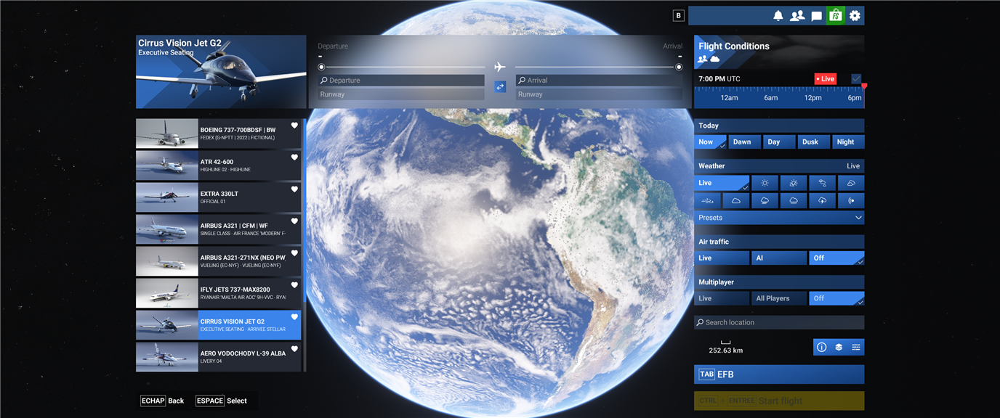
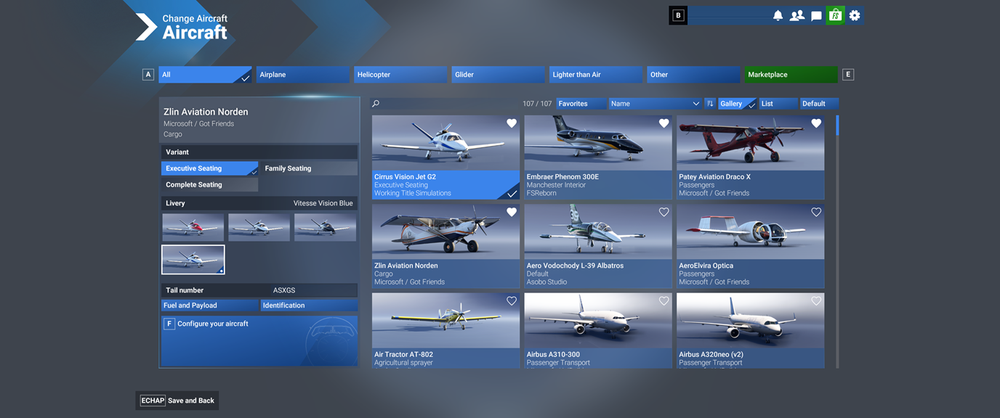
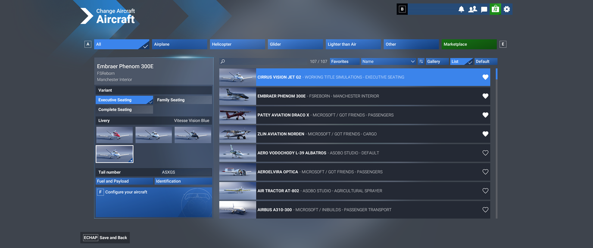
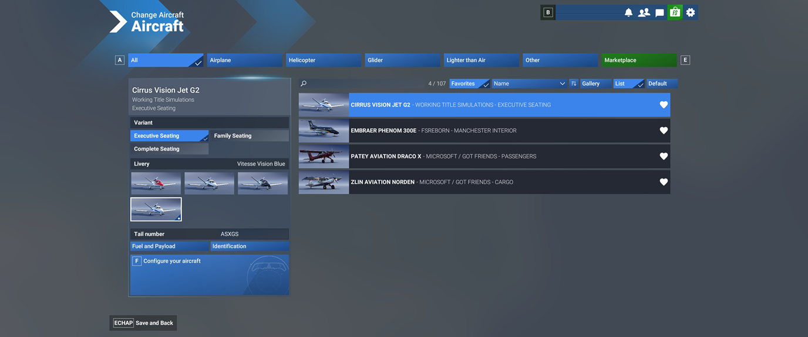

# MSFS-UI

A mod of the **Microsoft Flight Simulator 2024** main menu, and the Windows app that installs it.

- **MSFS-UI-GENERATOR**, the app: choose the features and their options, generate the `msfs-ui` package and install it in the sim's Community folder, check that the sim still offers what the mod needs.
- **msfs-ui**, the package: faster menus; a weather and time bar on Free Flight with presets, METAR, sun times and traffic; the wheel on the time; favourite liveries loaded in one click; an aircraft gallery and list with search, favourites and sorts, and a side by side layout with the current aircraft's liveries as large tiles; a setup panel for variants, liveries and tail number; a tail number per livery. Everything it shows is made of the sim's own components.

> [!WARNING]
> A personal project, not affiliated with, endorsed by or supported by Microsoft or Asobo Studio. The mod relies on undocumented parts of the sim's menu that an update may change: use it at your own risk. **Remove** on the app's Home page brings the original menu back; no file of the sim is ever modified.

Version 2.0.0, tested on MSFS 2024 1.9.21 (Steam), base package `fs-base-ui` 0.1.10.

## Screenshots

Free Flight: favourite liveries on the left; on the right the weather and time bar (the sim's presets, those of other packages in *Presets*, the traffic), with *Search location* under it.



Aircraft selection: the gallery, the list, and the favourites first; the setup panel on the left (variant, livery, tail number). The *Side by side* layout (an option in MSFS-UI-GENERATOR) shows the current aircraft's liveries as large tiles next to the aircraft.







## Repository

```
generator/   MSFS-UI-GENERATOR (.NET 10, WinUI 3): the app, its library, its tests and a developer tool
mod/         the menu mod (TypeScript), installed in the sim as the msfs-ui package
docs/        documentation; docs/images/ holds the screenshots
tools/       msfs-sdk-mcp, the MSFS 2024 SDK for Claude Code (MCP server); make-icon.ps1, the app's icon
build-release.ps1   the release: release\MSFS-UI-GENERATOR\ and its zip
```

## Build

```powershell
cd mod; npm ci; npm run check; cd ..
dotnet build generator/MsfsUi.slnx
dotnet test generator/MsfsUi.slnx
```

Then run `generator\MsfsUi.App\bin\Debug\net10.0-windows10.0.26100.0\win-x64\MSFS-UI-GENERATOR.exe`.

## Documentation

| Document | For | Content |
|---|---|---|
| [User guide](docs/user-guide.md) | Users | Installing, the app's pages, every feature of the mod in the sim, after a sim update, troubleshooting |
| [Development](docs/development.md) | Developers | Repository, build and tests, the developer tool, how the package works, the contracts between the app and the mod, working method, rules, the app's structure |
| [Sim reference](docs/sim-reference.md) | Developers | What the mod uses from the MSFS 2024 menu: files, screens, data model, events, storage, Coherent GT constraints |
| [Next steps](docs/next-steps.md) | Everyone | Where the project stands and what comes next, in order |
| [Feature ideas](docs/feature-ideas.md) | Everyone | Features that could come next, with what the sim offers and an estimate |
| [Mod](mod/README.md) | Developers | The menu mod's build, contracts, sources and the sim's components it uses |
| [Changelog](CHANGELOG.md) | Everyone | What each version brings |

## How it works

The menu of MSFS 2024 is an HTML page run by Coherent GT. The `msfs-ui` package replaces the menu's root component, the MasterPage, with a copy made on the user's machine from the installed sim, plus a small loader that imports the mod. The mod works on the menu's own objects, and everything it changes is undone when it unloads, so that it reloads live while the sim runs. The repository holds no file of Asobo.

## License

MSFS-UI is released under the [MIT License](LICENSE), © 2026 Proxi64. *Microsoft Flight Simulator* is a trademark of Microsoft Corporation; the screenshots show the sim's own menu with the mod.
